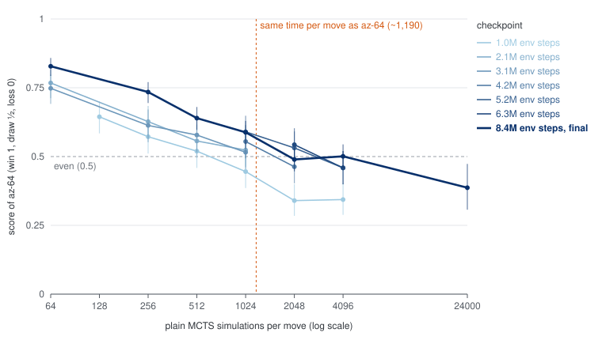

# Baselines

Single-file reinforcement-learning baselines for the 1v1 duel (11×11,
standard rules), trained by self-play on slinky.

| baseline | file | training | vs `random_legal` | vs heuristic | checkpoint |
|---|---|---|---|---|---|
| Double DQN | `dqn.py` | 31 min, 1.28M env steps | 0.998 | 0.053 | `checkpoints/dqn-duel-seed0/` |
| PPO | `ppo.py` | 67 min, 5.24M env steps | 0.998 | 0.296 | `checkpoints/ppo-duel-seed0/` |
| Rainbow DQN | `rainbow.py` | 81 min, 1.28M env steps | 0.983 | 0.084 | `checkpoints/rainbow-duel-seed0/` |
| AlphaZero (`az-64`) | `az.py` | 9.7 h, 8.39M env steps | 0.999 | 0.853 | `checkpoints/az-duel-seed0/` |

- **Hardware:** the DQN and PPO trained on a 4-core cloud CPU (PPO pinned to
  3 cores), Rainbow on a thermally throttled laptop CPU, AlphaZero on the
  4-core cloud CPU; no GPU.
- **AlphaZero** is scored as `az-64`: the network with 64 simulations of
  search per move (7 ms per move with 32 games in flight on one core). The
  raw network alone (`az-0`) scores
  0.997 and 0.484. See [AlphaZero](#alphazero-azpy).
- **Head-to-head:** PPO beats the DQN 0.868 over 1,024 games (888 / 2 / 134).
  See [the three compared](#the-three-compared) for all the pairings.
- **Sources:** the DQN and PPO scores are from the strength benchmark
  ([`benchmarks/README.md`](../benchmarks/README.md); 1,024 games each), as
  are AlphaZero's (512 games each).
  Rainbow is not in that benchmark; its scores are from its own evaluation
  (5,000 games against `random_legal`, 1,000 against the heuristic). In its
  own 5,000-game evaluation below, the DQN scores 0.993 against
  `random_legal`.

### The three compared

The three committed checkpoints in one harness (`slinky.evaluate.play_match`:
seats alternate, greedy play, the same seed 2026 for every match; score is
win + ½ draw with its 95% interval):

| match | games | W / D / L | score |
|---|--:|---|---|
| PPO vs DQN | 1,000 | 872 / 1 / 127 | 0.873 ± 0.021 |
| PPO vs Rainbow | 1,000 | 751 / 5 / 244 | 0.753 ± 0.027 |
| Rainbow vs DQN | 1,000 | 499 / 10 / 491 | 0.504 ± 0.031 |

| agent | vs `random_legal` (5,000 games) | vs heuristic (1,000 games) |
|---|---|---|
| DQN | 0.992 ± 0.002 (4951 / 16 / 33) | 0.047 ± 0.013 (45 / 4 / 951) |
| PPO | **0.996 ± 0.002** (4967 / 22 / 11) | **0.286 ± 0.025** (196 / 181 / 623) |
| Rainbow | 0.983 ± 0.003 (4896 / 33 / 71) | 0.084 ± 0.017 (78 / 12 / 910) |

- **PPO is the strongest of the three** on every count. It beats both DQNs
  head to head and scores 3–6 times as much as either against the heuristic.
  These agree with the strength benchmark (PPO vs DQN 0.868, PPO vs heuristic
  0.296).
- **Rainbow and the DQN are level** head to head, but Rainbow holds up
  better against PPO: 0.247 against PPO's 0.753, where the DQN gets 0.127.
  Rainbow also scores more against the heuristic (0.084 against 0.047).
- **The budgets differ.** PPO trained on 4.1 times as many env steps (5.24M
  against 1.28M). Its env steps are cheaper, so the wall time was similar.
  At about the same env steps, PPO's training evaluations (256 games, below)
  were already ahead: 0.615 against the DQN and 0.119 against the heuristic
  at 1.05M steps, where Rainbow and the DQN at 1.28M score 0.504 against each
  other and 0.084 and 0.047 against the heuristic. An equal-budget comparison
  would need longer DQN and Rainbow runs.
- **One seed each**, so the run-to-run spread of each algorithm is unknown.

```bash
uv pip install -e ".[rl]"            # adds optax
python baselines/dqn.py              # default run, ~30 min on a 4-core CPU
python baselines/ppo.py              # default run, ~70 min on 3 cores
python baselines/dqn.py --help       # every hyperparameter is a flag (same for ppo.py)
python baselines/dqn.py --eval-only runs/dqn-<timestamp> --eval-games 5000
python baselines/dqn.py --resume runs/dqn-<timestamp>   # continue an interrupted run
python baselines/rainbow.py          # Rainbow DQN; same flags, plus its own
python baselines/rainbow.py --n-step 1 --per-alpha 0    # ablate components
python baselines/az.py               # AlphaZero, 4-4.5 h on 4 cores (see below)
python baselines/dashboard.py        # live training dashboard (see below)
```

Each run writes to `runs/` (gitignored):

- `config.json`;
- `metrics.jsonl`, one record per log chunk (16k env steps for the DQN, 32k
  for PPO and AlphaZero) plus the evaluations;
- `params.npz`, the latest network;
- `runner.npz`, the full training state used by `--resume` (AlphaZero also
  saves its replay buffer, `replay.npz`).

## Watching training live

```bash
python baselines/dashboard.py        # then open http://127.0.0.1:8050
```

`dashboard.py` serves a page that lists every run under `runs/` and
`baselines/checkpoints/` (DQN, PPO, Rainbow and AlphaZero alike) and re-reads its
`metrics.jsonl` every 5 seconds, so a run in progress updates as it trains.

- **Run cards** show live / finished / stopped, progress and an ETA, and the
  latest greedy score against `random_legal`. Click a card to add the run to
  the charts or take it off (up to 8, each keeping its colour). Live runs and
  the committed checkpoints are shown at first.
- **Charts** (over env steps, one shared axis):
  - greedy score against each evaluation opponent, with its 95% interval:
    `random_legal` for every run, plus the heuristic and the DQN for PPO;
    AlphaZero runs plot their network-plus-search agent against the
    heuristic, the DQN, Rainbow, PPO and MCTS-64;
  - training loss (log scale; DQN's Huber loss, Rainbow's KL and
    AlphaZero's cross-entropy plus value error are not comparable), and
    PPO's or AlphaZero's value loss;
  - the value estimate: mean Q of the moves taken, or PPO's or AlphaZero's
    mean value-head output;
  - PPO's and AlphaZero's policy entropy;
  - self-play game length and draw rate, and throughput;
  - ε or the noisy-net σ.
- **Death causes**: the share of self-play eliminations by cause, per run.
- Hover (or focus a chart and use ←/→) for exact values; every chart also has
  a table view.

It needs only the standard library. It binds to `127.0.0.1` and answers only
requests addressed to localhost; `--host 0.0.0.0` serves it on the network,
and `--port` or extra directory arguments change where it listens and looks.

## Opponent: `random_legal`

The reference opponent is `slinky.evaluate.random_legal`, the "naive snake":

- Each turn it picks uniformly among the moves that don't *certainly* die
  next turn. It never steps into a wall or a body when it has another choice,
  and it applies the tail rule exactly.
- It ignores food, head-to-heads and being trapped.

Every score below comes from `slinky.evaluate.play_match`:

- seats alternate across games;
- win = 1, draw = ½, loss = 0;
- ± is a 95% confidence interval.

## DQN (`dqn.py`)

Double DQN with one network playing both snakes (parameter-sharing
self-play).

- **Acting.** Each snake picks from its own egocentric observation, a
  `21×21×13` board centred on its head. It plays epsilon-greedily, but only
  among its legal moves.
- **Learning.** The replay buffer stores compact game states and recomputes
  observations when it samples. Each game transition gives one training
  example per snake. Dying, winning (+1) and drawing end the episode for
  value purposes; truncation at `max_turns` does not, so it bootstraps.
- **Network.** Convolutions 32 → 64 → 64 with strides 2, 2, 1, then dense 256,
  then 4 Q-values (650k parameters).
- **Optimiser.** Adam at 5e-4, Huber loss, gradient clipping at 10, γ = 0.99,
  and a hard target-network update every 250 updates.
- **Schedule.** 32 games run in parallel, with 1 update of 128 game
  transitions per step. ε decays from 1 to 0.05 over the first 30% of
  training.

### Results

Default config, seed 0, 1.28M env steps (2.56M agent-transitions, 39.7k
gradient updates). It took **31 minutes** on a 4-core cloud CPU with no GPU,
at about 720 env-steps/s and 22 updates/s.

**Greedy DQN vs `random_legal` during training** (1,000 games each):

| env steps | wins | draws | losses | score | mean game length |
|--:|--:|--:|--:|---|--:|
| 256k | 982 | 7 | 11 | 0.986 ± 0.007 | 27 |
| 512k | 992 | 3 | 5 | 0.994 ± 0.005 | 27 |
| 768k | 996 | 3 | 1 | 0.998 ± 0.003 | 35 |
| 1.02M | 984 | 7 | 9 | 0.988 ± 0.006 | 36 |
| 1.28M | 993 | 4 | 3 | 0.995 ± 0.004 | 41 |

**Final checkpoint, re-evaluated with fresh seeds:**

| match | games | W / D / L | score |
|---|--:|---|---|
| **DQN (1.28M steps) vs `random_legal`** | 5,000 | 99.2% / 0.2% / 0.6% | **0.993 ± 0.002** |
| untrained network of the same architecture vs `random_legal` | 1,000 | 41% / 18% / 41% | 0.498 ± 0.028 |
| `random_legal` vs `random_legal` | 2,000 | 40% / 18% / 42% | 0.490 ± 0.020 |

The DQN row is 4,962 wins, 9 draws and 29 losses.

The second row uses initialisation seed 100. Initialisation seed 101 scored
0.423 ± 0.029.

**How it wins.** In a separate 4,000-game check (score 0.994), 91% of
`random_legal`'s deaths were head-to-head collisions. The DQN snake ends
games longer than its opponent (5.7 vs 4.5 segments on average), and most
games are short (median 26 turns). These statistics suggest it grows first,
then hunts: it stays close to the shorter snake, whose random moves then
walk into losing head-to-heads. This reading comes from aggregate statistics;
I did not inspect replays.

**Self-play dynamics.**

- Early on, almost all self-play deaths are head-to-heads (85% at 128k
  steps).
- Once exploration bottoms out, games between the two copies more than double
  in length, from about 60 to 130 turns. Head-to-heads fall to about 55–60%
  of deaths, and self- and body-collisions rise.
- The mean Q-value of taken actions peaks at +0.47 and settles at about
  +0.27. In a symmetric zero-sum game it would be near 0 with no bias, so the
  network overestimates its values. That did not stop it from beating the
  baseline.

### Caveats and next steps

- **One seed.** This is a single training run, not a seed sweep.
- **The opponent is weak.** `random_legal` is a sanity-check opponent, and
  this benchmark is now saturated. Against stronger reference agents
  ([`benchmarks/README.md`](../benchmarks/README.md); 1,024 or 512 games
  each):
  - the hand-written heuristic beats this DQN 0.947 (967 / 6 / 51);
  - on the MCTS scale, the DQN beats MCTS with 4 simulations (MCTS scores
    0.427) and loses to MCTS with 16 (0.947);
  - PPO self-play on the same setup (below) beats it 0.868.

  Still to try: past checkpoints and other algorithms (Elo or TrueSkill over
  a population).

The final network from this run is kept in
[`checkpoints/dqn-duel-seed0/`](checkpoints/dqn-duel-seed0/) (2.6 MB) as a
fixed opponent for benchmarks:
`python baselines/dqn.py --eval-only baselines/checkpoints/dqn-duel-seed0`.

## PPO (`ppo.py`)

PPO-clip with one actor-critic network playing both snakes (parameter-sharing
self-play), in the style of cleanRL and PureJaxRL. The file is self-contained:
it shares no code with `dqn.py`.

- **Acting.** Each snake samples from a softmax over its legal moves only:
  illegal moves get a logit of -1e9, so their probability is exactly 0 while
  the entropy and the gradients stay finite. The observation is the DQN's
  egocentric `21×21×13` board.
- **Rollouts.** 64 games run in parallel for 128 turns per iteration, and a
  finished game is replaced at once. Every turn gives one sample per living
  snake, so an iteration has 16,384 samples.
- **Episodes.** A snake's episode ends when it dies (-1), wins (+1) or draws
  (0), with no bootstrapping. A game cut off at `max_turns` bootstraps from the
  value of the state reached. GAE never crosses the end of an episode.
- **Network.** Convolutions 16 → 32 → 32 with strides 2, 2, 1, then dense 256,
  then a 4-logit policy head and a value head (312k parameters). That is half
  the DQN's channels: twice the env steps per second, and as strong per minute
  of training in pilots.
- **Optimiser.** 4 epochs of 8 minibatches (2,048 samples) per iteration;
  Adam at 1e-3 decayed linearly to 0, gradient clipping at 0.5. γ = 0.99,
  λ = 0.95, clip 0.2, value coefficient 0.5 (clipped value loss), entropy
  coefficient 0.01, advantages normalised per minibatch.
- **Speed.** The convolutions use a hand-written backward pass. XLA's own
  convolution gradient inside `lax.scan` is about 70 times slower on CPU.
  Training runs at about 1,400 env-steps/s on 3 pinned cores, and the
  updates take about 90% of the time.
- **Play mode.** The `ppo` agent in `slinky.agents` plays greedily (the masked
  argmax); `ppo-sample` samples. Greedy was ahead or within noise in every
  evaluation, and it beats sampled play 0.549 head-to-head (below).

### Results

Default config, seed 0, 5.24M env steps (10.5M agent samples, 20,480 gradient
steps). It took **67 minutes** on 3 pinned cores of a 4-core cloud CPU, five
evaluation rounds included.

**During training** (256 games per cell, greedy / sampled score; ± is at most
0.06 against the DQN and 0.05 against the heuristic):

| env steps | vs `random_legal` | vs DQN | vs heuristic | W / D / L vs heuristic (greedy) |
|--:|---|---|---|---|
| 1.05M | 0.986 / 0.992 | 0.615 / 0.510 | 0.119 / 0.064 | 17 / 27 / 212 |
| 2.10M | 1.000 / 0.994 | 0.686 / 0.541 | 0.121 / 0.098 | 23 / 16 / 217 |
| 3.15M | 0.996 / 0.982 | 0.777 / 0.791 | 0.225 / 0.186 | 34 / 47 / 175 |
| 4.19M | 0.986 / 0.992 | 0.836 / 0.828 | 0.232 / 0.242 | 33 / 53 / 170 |
| 5.24M | 1.000 / 0.996 | 0.836 / 0.848 | 0.338 / 0.268 | 60 / 53 / 143 |

**Final checkpoint in the strength benchmark** (fresh games;
[`benchmarks/README.md`](../benchmarks/README.md)):

| match | games | W / D / L | score |
|---|--:|---|---|
| PPO vs `random_legal` | 1,024 | 1020 / 3 / 1 | 0.998 [0.992, 0.999] |
| PPO vs DQN | 1,024 | 888 / 2 / 134 | 0.868 [0.846, 0.888] |
| PPO vs heuristic | 1,024 | 205 / 197 / 622 | 0.296 [0.269, 0.325] |
| PPO greedy vs PPO sampled | 512 | 280 / 2 / 230 | 0.549 [0.506, 0.591] |

- **Against the heuristic:** 0.296 over 1,024 games, against 0.338 in the
  final 256-game training evaluation; the two agree within noise.
- **On the MCTS scale**, PPO plays between 4 and 16 simulations. MCTS-4
  scores 0.127 against it and MCTS-16 0.642, while MCTS at 500 ms per move
  (24,000 simulations) scores 0.949.
- **How it loses:** against MCTS-2048 and MCTS-4096, PPO wins 6.4–6.6% of
  its games (the heuristic 0.4–2.7%). But it draws far less and loses more,
  so it scores 0.09 against them while the heuristic scores 0.15–0.16.

**Self-play dynamics.**

- Early on, 82% of self-play deaths are head-to-heads and games last about 55
  turns.
- By the end, games between the two copies last about 195 turns,
  head-to-heads are down to about 20% of deaths, and running into its own
  body is the most common death (about half).
- The policy's entropy falls from 0.90 to 0.24 nats.
- The value function stays weak: explained variance is only 0.1–0.2. A review
  found no bug behind it, and turning off value clipping or raising the value
  coefficient did not help in a short A/B run. The policy still gets the
  outcome through the GAE returns.

**Pilots.** The defaults come from 1M-step pilots on one core each (about 30
minutes):

- **A learning rate of 2.5e-4 collapses into opening head-on draws.** That
  pilot scored a misleading 0.36 against the heuristic with zero wins, while
  scoring 0.10 against the DQN and 0.83 against `random_legal`. Read the
  W/D/L, not just the score.
- **Smaller rollouts hurt.** 32 games × 64 turns at lr 2e-3 scored 0.07
  against the heuristic.
- **Within noise of each other:** lr 1e-3 and 2e-3, γ 0.99 and 0.995, a
  constant learning rate, and the DQN-sized network at equal wall time.
- **Greedy beats sampled.** In a 1,024-game paired evaluation, greedy scored
  0.196 against 0.160 vs the heuristic, and 0.567 against 0.504 vs the DQN.

### Caveats

- **One seed**, like the DQN.
- **Still improving.** Against the heuristic the score rose from 0.23 to 0.34
  over the last million steps, while the learning rate decayed to 0. A longer
  run would probably be stronger.
- **Resuming is exact only with the same number of CPU cores**: the
  floating-point reductions depend on the thread count.

The final network from this run is kept in
[`checkpoints/ppo-duel-seed0/`](checkpoints/ppo-duel-seed0/) (1.3 MB) as the
default `ppo` agent:
`python baselines/ppo.py --eval-only baselines/checkpoints/ppo-duel-seed0`.

## Rainbow DQN (`rainbow.py`)

All six extensions of Rainbow (Hessel et al., 2018) on top of the same
self-play setup as `dqn.py`: one network for both snakes, egocentric
observations, legal moves only, and compact game states in the replay
buffer. Every component except the distributional head can be switched off
from the command line, for ablations.

- **Distributional (C51).** Each move's return is a categorical distribution
  over 51 atoms. A snake's return in this game always lies in [−1, 1] (−1 for
  dying, +1 for winning, nothing in between), so the support is exactly
  [−1, 1] and no target is ever clipped. The loss is the KL divergence to the
  projected target, which has the same gradient as the cross-entropy.
- **Double Q-learning** (`--double`): the online network picks the bootstrap
  move (on expected values, legal moves only); the target network supplies
  its distribution.
- **Dueling heads** (`--dueling`): value and mean-centred advantage streams,
  per atom.
- **3-step returns** (`--n-step`). The last `n` one-step transitions of every
  game slot sit in a sliding window. Each step, the oldest becomes an `n`-step
  transition. The window stops at the end of a game: the rules ending it
  makes the return final, while a `max_turns` cut-off still bootstraps.
  Each snake gets its own discount, 0 once it is dead.
- **Prioritized replay** (`--per-alpha`, `--per-beta-*`): proportional, on the
  KL loss, α = 0.5, with importance weights annealed from β = 0.4 to 1.
  Sampling is a stratified draw from a cumulative sum over the buffer (about
  1.7 ms per batch here, cheaper than maintaining a sum tree in JAX).
  `--per-alpha 0` is uniform replay.
- **Noisy nets** (`--noisy`): factorized Gaussian noise (σ₀ = 0.5) on the
  dense layers instead of ε-greedy. Each snake draws its own noise when
  acting. Learning draws one sample per batch per network evaluation;
  per-sample noise there would cost about 40 ms per update. Evaluation plays
  the mean weights.

Other settings, mostly as `dqn.py`: the same convolutional trunk and dense
256 layer (1.37M parameters, since noisy layers hold a σ per weight), Adam
at 2.5e-4 with ε = 1.5e-4, gradient clipping at 10, γ = 0.99, a hard
target-network copy every 250 updates, a 100k buffer, learning from 10k, and
32 games with one update of 128 game transitions per step.

### Results

Default config, seed 0, the same budget as the DQN: 1.28M env steps, 39.7k
updates. It took **81 minutes** on a 12-thread laptop CPU that was thermally
throttled to about 2.2 GHz, at about 275 env-steps/s. Early in training,
on the same machine, Rainbow ran at about 79% of the DQN's speed (358 vs 454
env-steps/s).

**Greedy Rainbow during training** (1,000 games each against `random_legal`;
512 games each against the heuristic, played afterwards from saved
checkpoints):

| env steps | vs `random_legal` | vs heuristic |
|--:|---|---|
| 256k | 0.954 ± 0.012 | 0.026 ± 0.010 |
| 512k | 0.967 ± 0.011 | 0.045 ± 0.017 |
| 768k | 0.982 ± 0.008 | 0.051 ± 0.019 |
| 1.02M | 0.981 ± 0.008 | 0.045 ± 0.018 |
| 1.28M | 0.989 ± 0.006 | 0.087 ± 0.024 |

**Final checkpoints compared** (same seeds for both agents):

| match | games | Rainbow | DQN |
|---|--:|---|---|
| vs `random_legal` | 5,000 | 0.983 ± 0.003 (4896 / 33 / 71) | **0.992 ± 0.002** (4951 / 16 / 33) |
| vs heuristic | 1,000 | **0.084 ± 0.017** (78 / 12 / 910) | 0.047 ± 0.013 (45 / 4 / 951) |
| Rainbow vs DQN | 1,000 | 0.504 ± 0.031 (499 / 10 / 491) | |
| vs PPO | 1,000 | **0.247 ± 0.027** (244 / 5 / 751) | 0.127 ± 0.021 (127 / 1 / 872) |

At the same budget, the two are level head to head. Rainbow is slightly
weaker against the random snake but scores about 1.8× as much against the
heuristic, and its score there was still rising at the end of training. Both
gaps are outside the 95% intervals.

**Self-play dynamics.**

- **Better-calibrated values.** The mean Q of the moves taken peaks at
  +0.10 and settles at about +0.04, against the DQN's +0.47 and +0.27. In a
  symmetric zero-sum game it should be near 0.
- **Longer games.** Self-play games last about 240 turns by the end, against
  the DQN's 136. The share of head-to-head deaths falls from 72% at 256k
  steps to about a third. Self-collisions rise to about 40%.
- **New transitions are replayed a lot.** New transitions get the largest
  priority seen so far, as in the prioritized-replay paper, and that maximum
  grows to about 12 while typical priorities are below 0.1. Fresh data is
  therefore oversampled for its first replays. Using the buffer's current
  maximum instead is a variant worth trying.

### Caveats and next steps

- **One seed**, as for the DQN, and the default hyperparameters were not
  tuned. A 320k-step pilot with the same settings scored 0.931–0.945
  against `random_legal`.
- **The heuristic score was still rising** at 1.28M steps. A longer run is
  the obvious next experiment, followed by ablations of the six components
  (the flags above).

The final network is kept in
[`checkpoints/rainbow-duel-seed0/`](checkpoints/rainbow-duel-seed0/) (5.5 MB)
as the `rainbow` agent of `slinky.agents`:
`python baselines/rainbow.py --eval-only baselines/checkpoints/rainbow-duel-seed0`.

## AlphaZero (`az.py`)

AlphaZero (Silver et al., 2018) on top of `slinky.mcts`: one network gives
move priors and position values, the simultaneous-move search plays with
them, and the network learns from the search's own self-play games. It is
all JAX in one process: self-play, search, replay and learning run as one
jitted chunk per log line, so the same file runs on a GPU unchanged (raise
`--num-envs`). The file is self-contained: it shares no code with `ppo.py`.

- **Network.** PPO's torso (the same `21×21×13` egocentric observation,
  convolutions 16 → 32 → 32, dense 256), a 4-logit policy head with illegal
  moves masked and a `tanh` value head: 312k parameters, evaluated for each
  snake from its own view.
- **Search.** Decoupled PUCT in `slinky.mcts.search`: each snake picks its
  own move at a node by `q + c_puct · P · sqrt(max(N, 1)) / (1 + n)`, where
  `q` is the move's mean value mapped to [0, 1] (so `c_puct` 0.5 is
  AlphaZero's 1.0 on its [-1, 1] scale), `n` the move's visits and `N` the
  snake's visits at the node. The priors `P` and the leaf values come from
  the network (exact values at finished positions). Unvisited moves start
  from the node's own value minus 0.2 on the [-1, 1] scale (first-play
  urgency). The network enters as a closure over traced
  parameters, so new weights never recompile, and under `vmap` each
  simulation is one batched network call for every game in flight.
- **Self-play.** 64 games, 64 simulations per move, Dirichlet noise in the
  root priors (25%, α = 0.5). The first 16 turns sample each snake's move
  from its root visit counts, later turns play the most visited move.
- **Targets.** Each living snake's root visit shares (policy) and its game's
  outcome (value): win +1, loss -1, a mutual elimination -0.5 (the search's
  draw value, so the network and the tree agree), a cut-off game 0.
- **Replay.** Positions are stored as compact game states (under 1 KB) with
  their visit shares; a game's outcome goes into a side table when it ends,
  and positions of games still running are skipped when sampled. Each
  sampled position gets a random one of the 8 board symmetries (the rules,
  observations and legal masks commute with all 8 exactly; tested).
- **Learning.** Cross-entropy to the visit shares plus the value MSE, AdamW
  at 1e-3 decayed linearly to 1e-4, 512 positions (1,024 samples) per
  gradient step, about 4 uses of each stored position.

```bash
python baselines/az.py               # default run: 4.2M env steps, 4-4.5 h on 4 cores
python baselines/az.py --total-env-steps 8388608 --buffer-capacity 262144 \
    --eval-opponents heuristic,dqn,rainbow,ppo,mcts-64 --run-dir runs/az-duel-seed0   # the run below
python baselines/az.py --eval-only baselines/checkpoints/az-duel-seed0 --eval-simulations 256
```

The trained network plays as `az-<n>` in `slinky.agents`: `n` simulations
of PUCT search per move, or `az-0` for the raw network (the legal argmax of
its policy). Search settings can be changed at play time, for example
`az-64:c_puct=0.25` or `az-64:leaf=heuristic`.

### Results

Seed 0, 8.39M env steps (about 39,000 self-play games, 65,296 gradient
steps). It took **9.7 hours** on a 4-core cloud CPU: 8.0 hours of training
and 1.7 hours of evaluations. Training ran at about 350 env steps/s for
the first 2M steps and 250–290 after, while benchmarks shared the machine.

**Final checkpoint in the strength benchmark** (512 games per cell, 95%
Wilson intervals; [`benchmarks/README.md`](../benchmarks/README.md#alphazero)):

| agent | vs `random_legal` | vs DQN | vs Rainbow | vs PPO | vs heuristic | ms per move |
|---|---|---|---|---|---|--:|
| `az-0` (raw network) | 0.997 [0.987, 0.999] | 0.844 [0.810, 0.873] | 0.714 [0.673, 0.751] | 0.581 [0.538, 0.623] | 0.484 [0.441, 0.528] | 0.26 |
| `az-64` | 0.999 [0.991, 1.000] | 0.994 [0.983, 0.998] | 0.984 [0.969, 0.992] | 0.943 [0.920, 0.960] | 0.853 [0.819, 0.881] | 7.0 |
| `az-256` | 0.999 [0.991, 1.000] | 0.995 [0.984, 0.998] | 1.000 [0.993, 1.000] | 0.987 [0.973, 0.994] | 0.872 [0.840, 0.898] | 26.3 |

- **With search it beats every learned baseline almost every game.**
  `az-256` won all 512 games against Rainbow and lost one in 512 to PPO
  (500 / 11 / 1).
- **The raw network, with no search, is the strongest learned policy here.**
  It beats PPO 0.581 and scores 0.484 against the heuristic, where PPO scores
  0.296; that is between MCTS-16 and MCTS-32 (0.321 and 0.528).
- **Against the heuristic** `az-64` scores 0.853 (395 / 83 / 34), level with
  MCTS at 2048–4096 simulations (0.846, 0.840) and at 500 ms per move
  (24,000 simulations, 0.875 over 128 games). Plain MCTS's score against the
  heuristic has saturated there; head to head, MCTS at 500 ms still beats
  `az-64` (below). `az-256` scores 0.872 and loses 7 games of 512.

**During training** (the run's own evaluations: 128 games per cell, ± up to
0.09; raw network / with 64 simulations):

| env steps | vs heuristic | vs DQN | vs Rainbow | vs PPO | vs MCTS-64 |
|--:|---|---|---|---|---|
| 1.05M | 0.391 / 0.805 | 0.641 / 0.930 | 0.516 / 0.859 | 0.336 / 0.781 | 0.301 / 0.793 |
| 2.10M | 0.430 / 0.793 | 0.734 / 0.984 | 0.695 / 0.938 | 0.457 / 0.863 | 0.332 / 0.730 |
| 3.15M | 0.434 / 0.832 | 0.766 / 1.000 | 0.695 / 0.992 | 0.492 / 0.918 | 0.324 / 0.680 |
| 4.19M | 0.418 / 0.832 | 0.797 / 0.992 | 0.715 / 1.000 | 0.465 / 0.938 | 0.348 / 0.863 |
| 5.24M | 0.477 / 0.824 | 0.734 / 0.984 | 0.676 / 0.969 | 0.520 / 0.895 | 0.477 / 0.816 |
| 6.29M | 0.480 / 0.855 | 0.840 / 1.000 | 0.676 / 0.984 | 0.457 / 0.953 | 0.344 / 0.805 |
| 7.34M | 0.504 / 0.816 | 0.781 / 0.977 | 0.750 / 0.953 | 0.535 / 0.930 | 0.395 / 0.805 |
| 8.39M | 0.488 / 0.844 | 0.820 / 0.992 | 0.703 / 0.984 | 0.523 / 0.969 | 0.402 / 0.852 |

- After 1M steps (about 50 minutes) the network with search already beats
  PPO, which trained for 5.24M steps. The raw network passes the DQN and
  Rainbow by 2M steps and is about level with PPO from 3M.
- The search's scores against the heuristic and MCTS-64 level off early
  (0.68–0.86 from 1M steps on, within the ±0.09 of these evaluations), while
  the plain-MCTS ladder below shows gains until about 5M steps.

**What the network is worth in plain simulations.** `az-64` against plain
MCTS with more and more simulations, at each checkpoint (256 games per point
for the snapshots, 512 for the final network except 128 at 24,000
simulations): where a line crosses 0.5 is
how many plain simulations the network's 64 are worth.



| checkpoint | vs MCTS-512 | vs MCTS-1024 | vs MCTS-2048 | vs MCTS-4096 | worth about |
|--:|---|---|---|---|---|
| 1.05M | 0.520 | 0.445 | 0.340 | 0.344 | 600 simulations |
| 2.10M | 0.557 | 0.523 | | | a little over 1,000 |
| 3.15M | 0.578 | 0.516 | | | a little over 1,000 |
| 4.19M | | 0.555 | 0.463 | | 1,500 |
| 5.24M | | 0.590 | 0.531 | 0.459 | 2,800 |
| 6.29M | | | 0.543 | 0.459 | 2,900 |
| 7.34M | | | 0.555 | 0.484 | 3,500 |
| 8.39M (final) | 0.640 | 0.588 | 0.489 | 0.501 | 2,000–4,000 |
| 8.39M, `c_puct` 0.25 at play time | | 0.664 | 0.612 | 0.592 | over 4,096 (0.574 against MCTS-24000) |

- **The crossings are rough.** A 256-game point is ±0.06, about one doubling
  of plain simulations on these slopes. Read the column as: the network's
  worth grew about fivefold over the first 5M steps and then flattened.
  The final network sits at 0.49–0.50 against both MCTS-2048 and
  MCTS-4096 (±0.043 each), so its crossing is no finer than 2,000–4,000.
- **At equal time.** `az-64` takes 7.0 ms per move on one core with 32 games
  in flight, what plain MCTS spends on about 1,190 simulations. At 1M steps
  the network was worth half its time in plain search; it drew level by
  2–3M steps, and from 5M on it is worth 2–3 times its time.
- **Against MCTS at 500 ms per move** (24,000 simulations, 27 times `az-64`'s
  time) `az-64` scores 0.387 [0.307, 0.473] over 128 games (36 / 27 / 65).
  `az-256`, at a seventh of that MCTS's time, scores 0.586 [0.499, 0.668]
  (57 / 36 / 35): level or slightly ahead.
- **On a GPU** the balance would likely shift further towards the network
  (not measured): almost all of `az-64`'s time is network evaluation (about
  0.1 ms per extra simulation, against 5–8 µs per extra plain simulation),
  which a GPU batches cheaply.

**Play-time settings** (final network; 512 games per cell, ± up to 0.045,
except 128 games, ± up to 0.085, against MCTS-24000):

| setting | vs MCTS-1024 | vs MCTS-2048 | vs MCTS-4096 | vs MCTS-24000 | vs heuristic | vs PPO |
|---|---|---|---|---|---|---|
| default (`c_puct` 0.5, network leaf values) | 0.588 | 0.489 | 0.501 | 0.387 | 0.853 | 0.943 |
| `c_puct=0.25` | 0.664 | 0.612 | 0.592 | 0.574 | 0.886 | 0.964 |
| `leaf=heuristic` (network priors, heuristic leaf values) | 0.574 | | | | | |

- **A smaller `c_puct` plays better** than the 0.5 the network trained with:
  higher in all six matchups, by 0.02 to 0.19. Against MCTS at 500 ms per
  move it scores 0.574 [0.488, 0.656] where the default scores 0.387
  [0.307, 0.473]: `az-64` with `c_puct` 0.25 is level with a search that
  takes 25 times as long. Whether self-play with 0.25 also trains a better
  network is untested.
- **The value head has caught up with the hand-written evaluation.** At 1M
  steps the heuristic leaf was worth +0.09 against MCTS-64 (pilots below);
  on the final network it is level within noise.

**Self-play dynamics.**

- Games between the two copies grew from about 180 turns (first million
  steps) to 240. Self-collisions are about half the deaths and head-to-heads
  a third (43% early on); draws stay at 1.4–3.2%: no collapse into opening
  head-on draws.
- The value head explains 11–17% of the outcome variance (averaged per
  million steps; 12.7% over the last million). That is measured on the
  network's own games, which grow longer and closer as it improves, so it
  understates progress. Measured against the heuristic leaf instead, the
  value head went from 0.09 behind it (the 1M-step pilot network, against
  MCTS-64) to level with it (the final network, against MCTS-1024).
- The policy loss sits about 0.04 nats above the entropy of its targets
  (0.73 against 0.69): the network nearly matches its search's visit
  shares, and the search improves on the network by the margins above.

**Pilots.** The configuration comes from 1M-step pilots on 2 cores each
(about an hour each), scored over 256 games with 64 simulations:

| pilot | vs heuristic | vs MCTS-64 | vs PPO |
|---|---|---|---|
| **from scratch** | **0.803** | **0.695** | **0.908** |
| expert iteration (0.5M steps learning from heuristic-leaf MCTS-256), then AlphaZero | 0.732 | 0.693 | 0.848 |
| the same, phasing the heuristic leaf out over the AlphaZero half | 0.715 | 0.660 | 0.812 |
| expert iteration only (0.5M steps) | 0.596 | 0.549 | 0.588 |

- **Learning from scratch was best.** Starting from a heuristic-MCTS teacher
  gave a fast start (0.305 raw against the heuristic after 24 minutes) but
  plateaued, and its value head carried over poorly.
- **`c_puct`** 0.25–0.5 at play time scored alike in the pilot (0.719 and
  0.695 against MCTS-64); 1.0 was clearly worse (0.609).
- **The value head was the bottleneck at 1M steps:** the heuristic leaf
  scored 0.783 against MCTS-64 where the network's own values scored 0.695.

### Caveats

- **One seed** and one network size (PPO's); a bigger network, more
  simulations in self-play or a longer run are untested.
- **CPU only.** Self-play is about 95% network evaluation on this CPU; the
  time comparisons above are for this machine.
- **The training evaluations are noisy** (128 games); the strength benchmark
  above has 512 games per cell.
- **The training snapshots are not committed**, only the final network; the
  ladder's snapshot rows are in `benchmarks/results/az_ladder.jsonl` with
  their parameter hashes.

The final network is kept in
[`checkpoints/az-duel-seed0/`](checkpoints/az-duel-seed0/) (1.3 MB) as the
default `az-<n>` agent.
